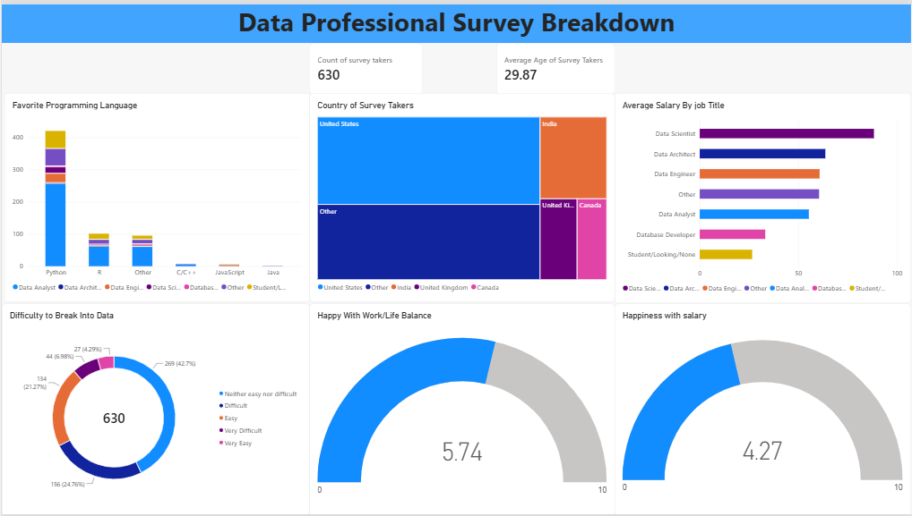
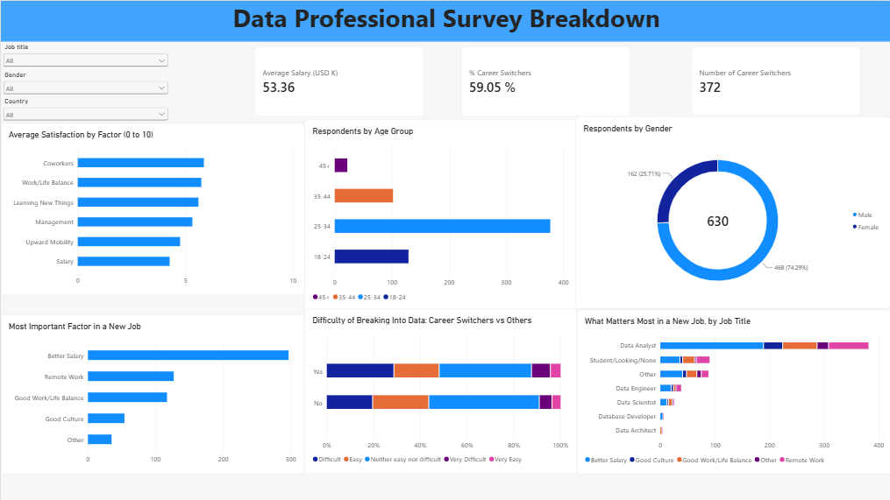

# Data Professional Survey Dashboard

An interactive two-page Power BI dashboard built from a survey of 630 data professionals.

### Page 1: Overview

### Page 2: Career and Satisfaction

## About this project
This project started as the final hands-on project of the Power BI tutorial
series by [Alex The Analyst](https://github.com/AlexTheAnalyst/Power-BI).
I followed the walkthrough to practice the full workflow (importing, cleaning
and visualizing data), then extended it with a second page and several
additions of my own.

## Objective
Explore what the data profession looks like: who works in it, what they earn,
which languages they use, how hard it is to break in, and how satisfied they are.

## Dataset
- Source: [Power BI - Final Project.xlsx](https://github.com/AlexTheAnalyst/Power-BI/blob/main/Power%20BI%20-%20Final%20Project.xlsx),
  from Alex The Analyst's Power BI repository
- Data Professional Survey: 630 respondents, 28 columns

## Tools
- Power BI Desktop
- Power Query Editor
- DAX

## Dashboard structure

### Page 1: Overview (from the tutorial)
- KPI cards: number of respondents and average age
- Favorite programming language
- Respondents by country (treemap)
- Average salary by job title
- Difficulty of breaking into data
- Satisfaction gauges (work/life balance and salary)

### Page 2: Career and Satisfaction (my extension)
- Slicers for job title, gender and country
- KPI cards: average salary, % career switchers and number of career switchers
- Average satisfaction by factor (all six survey criteria)
- Respondents by age group
- Respondents by gender
- Most important factor when looking for a new job
- Difficulty of breaking into data: career switchers vs others (100% stacked bar)
- Job priorities by job title

## Data preparation
- Removed unnecessary columns in Power Query
- Split salary ranges (e.g. "41k-65k") into low and high values and averaged them
  to create an estimated **Average Salary**
- Created a separate `Satisfaction` table by unpivoting the six satisfaction
  columns, so they can be compared in one chart

## What I added beyond the tutorial
- A second report page focused on careers and satisfaction
- Slicers for job title, gender and country
- An **Age Group** calculated column
- A **% Career Switchers** measure written in DAX
- An unpivoted `Satisfaction` table to compare all six satisfaction factors
- A 100% stacked bar comparing career switchers with non-switchers

## Key insights
- **Salary is the top priority and the lowest satisfaction score.** "Better Salary"
  is the most important factor for nearly half of respondents, yet salary
  has the lowest satisfaction score.
- **59% of respondents switched careers into data** (372 out of 630).
- **Career switchers found it harder to break in:** 28.5% called it "Difficult"
  versus 19.4% of non-switchers.
- Most respondents are aged **25 to 34**, and about **74% are male**.
- Coworkers and work/life balance get the highest satisfaction scores.

## Limitations
- Salary is an estimate based on the midpoint of survey salary ranges.
- Some job titles have few respondents, so their averages are less reliable.
- Some free-text answers fall under "Other".

## How to use
1. Download the dataset from the link in the Dataset section.
2. Open `Data_Professional_Survey.pbix` in Power BI Desktop.
3. If asked, point the data source to your local copy of the Excel file.

## Credits
Tutorial and dataset: [Alex The Analyst](https://github.com/AlexTheAnalyst/Power-BI).
Dashboard built by Hasnae SEBBAR
